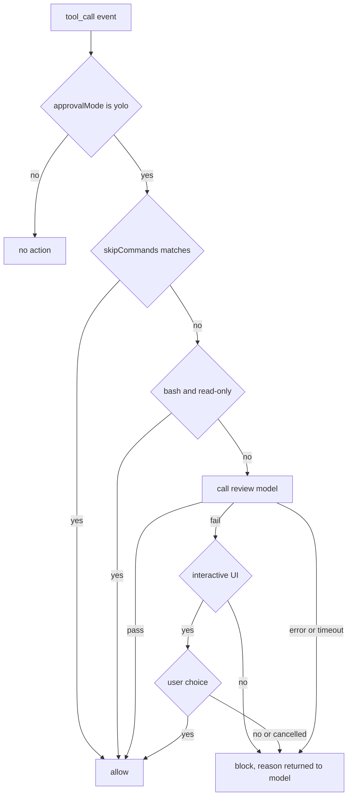

> [简体中文](README.md) · [English](README.en.md)

# omp-command-review

An oh-my-pi (omp-zh) extension. In `yolo` approval mode it asks a review model to classify each tool call before execution, and reduces the answer to two outcomes: pass, so omp runs it, or fail, so the user decides. The plugin does not modify omp's source.

**Requirements**: omp-zh ≥ 18.12.6; a review endpoint that speaks Chat Completions, Responses, or jev (TypeSafe System One).

## Outcomes

| Outcome | Behavior |
| --- | --- |
| Pass | omp continues and runs the call |
| Fail | The UI shows the reason and the full call content, then asks yes/no; the call runs only on “yes” |

Review failures and timeouts are treated as fail. On timeout the request is aborted and the budget, endpoint, model, and API format are embedded in the block reason returned to the working model, so it can adjust its next step.

## Flow



## Installation

From the plugin directory:

```sh
omp-zh plugin install .
```

Restart omp-zh afterwards. For development you can load the extension without installing:

```sh
omp-zh --extension /absolute/path/to/omp-plugin-Command-review
```

## Configuration

### Files and precedence

Two YAML files are read:

| Scope | Path |
| --- | --- |
| Global | `~/.omp/agent/command-review.yml` |
| Project | `<project>/.omp/command-review.yml` |

Per field, the value is taken from: project file > global file > `omp-zh plugin config` > environment variable > default.

An unknown field or a type error does not fall back to permissive defaults; the plugin blocks the call under its safety policy.

### Fields

| Field | Type | Default | Description |
| --- | --- | --- | --- |
| `endpointUrl` | string | none | Review service URL. With `api=jev` the endpoint is derived as described below. |
| `api` | enum | `chat-completions` | `chat-completions`, `responses`, or `jev`. |
| `model` | string | none | Review model ID. With `api=jev`, a TypeSafe model name such as `jev-1.14.0`. |
| `apiKey` | string | none | Literal key, or `${ENV_NAME}` to read one from the environment. |
| `apiKeyEnv` | string | none | Environment variable holding the key; takes precedence over a literal `apiKey`. |
| `skipCommands` | string[] | `[]` | Glob list of skipped entries; a comma- or newline-separated string is also accepted. |
| `auditLogEnabled` | boolean | `false` | Write audit records to a JSON log inside the project. |
| `thinkingEnabled` | boolean | `false` | Reasoning mode; applies to `chat-completions` and `responses` only. |
| `reviewTimeoutMs` | number | `20000` | Review request timeout in milliseconds; the host hook budget may shorten it (see [Timeout](#timeout)). |

### Full example

```yaml
endpointUrl: https://api.example.com/v1
api: chat-completions
model: gpt-4o-mini
apiKeyEnv: OMP_COMMAND_REVIEW_API_KEY
auditLogEnabled: true
thinkingEnabled: false
reviewTimeoutMs: 20000
skipCommands:
  - "read"
  - "grep"
  - "glob"
  - "edit"
  - "write"
  - "npm test*"
  - "pnpm lint"
```

### How skipping matches

`skipCommands` tests two candidates: the tool name, and the review text (the command for bash, the serialized input for other tools). A match on either one skips the call without contacting the model.

Patterns are whole-string globs with implicit anchors, supporting `*`, `?`, and character sets. So `read` does not match a tool named `reader`, nor command text like `read_file`. To allow a prefix, write it explicitly, for example `npm test*`.

`read`, `grep`, `glob`, `edit`, `write` and similar tools are not hardcoded. Adding the name to `skipCommands` skips it; removing the entry restores review. The example above already lists them and can be copied as-is.

## Using jev

`jev` uses the TypeSafe System One endpoint, not an OpenAI-compatible one. The plugin sends a single `choice` question with the content in `state`:

```json
{
  "model": "jev-1.14.0",
  "state": "bash\nrm -rf ./build",
  "questions": {
    "decision": {
      "type": "choice",
      "instructions": "…decide whether this tool call can run without human confirmation.",
      "criteria": {
        "pass": "Read-only, or confined to the current project and reversible; …",
        "review": "Deletion, overwrite… or consequences that are unclear and need a human."
      }
    }
  }
}
```

Only `answers.decision.choice` is read: `pass` means pass, `review` means fail. Free text is not parsed. A missing `answers`, a `type` other than `choice`, a `choice` outside `pass`/`review`, or a non-success HTTP status all count as a review failure and block the call.

`endpointUrl` derivation:

| Configured value | Request URL |
| --- | --- |
| `https://www.dmxapi.cn` | `https://www.dmxapi.cn/typesafe/v1/systemone` |
| Ends with `/v1`, e.g. `https://api.typesafe.ai/v1` | `/systemone` appended |
| Ends with `/systemone` | used as-is |

Any other shape cannot be derived reliably, and the plugin raises an error instead of sending the request to a guessed path.

```yaml
endpointUrl: https://www.dmxapi.cn
api: jev
model: jev-1.14.0
apiKeyEnv: OMP_COMMAND_REVIEW_API_KEY
skipCommands:
  - "read"
  - "grep"
  - "glob"
  - "edit"
  - "write"
```

`jev` ignores `thinkingEnabled`.

## Behavior

- Only tool calls are intercepted, and only when the effective `tools.approvalMode` is `yolo`. The `tool_call` event carries no approval mode, so the plugin reads the value from the settings registry instead of waiting for an approval request that yolo never raises.
- Clearly read-only shell commands such as `git status`, `rg`, `cat`, and `npm list`, including chains made only of them, are allowed without contacting the model. Write redirections, shell expansion, unknown programs, or commands that may change state are not treated as read-only.
- For non-bash tools the review text is the input JSON, truncated at 8000 characters with a marker.
- Model errors, malformed responses, timeouts, and the absence of an interactive UI all block execution and return the reason to the working model. A cancelled selector or an unrecognized choice counts as a refusal.
- Skipped entries bypass review and confirmation entirely; keeping those patterns narrow is the user's responsibility.

## Timeout

Each review request has its own deadline. The effective value is the smaller of `reviewTimeoutMs` and 80% of the host's `extensionHandlers.toolCallTimeoutMs`, which defaults to 30000 ms. On timeout the request is aborted, an `error` audit record is written, and the call is blocked as a failure.

To allow longer reviews, raise the host limit first, then set a smaller plugin timeout:

```yaml
# ~/.omp/agent/config.yml
extensionHandlers:
  toolCallTimeoutMs: 60000
```

```yaml
# <project>/.omp/command-review.yml
reviewTimeoutMs: 45000
```

## Logging

With `auditLogEnabled: true` every reviewed call and its outcome is written inside the current project:

```text
<project>/.omp/command-review-audit.json
```

The file is a JSON array. Each append reads the current content, rewrites it in full, and replaces it atomically; writes within one directory are serialized so concurrent calls cannot overwrite each other.

```json
[
  {
    "timestamp": "2026-10-24T00:00:00.000Z",
    "tool": "bash",
    "command": "rm -rf ./build",
    "input": "bash\nrm -rf ./build",
    "api": "jev",
    "model": "jev-1.14.0",
    "thinkingEnabled": false,
    "verdict": "review",
    "reason": "JEV 判定需要人工审查（置信度 0.98）。",
    "outcome": "blocked"
  }
]
```

`outcome` is `allowed`, `blocked`, or `error`; error records carry the message, and timeouts are recorded as `error`. Logging is off by default. A failed write does not change the review result and does not interrupt the flow.

Logs can contain commands, paths, arguments, and file fragments. Confirm the project may store them, and add `.omp/command-review-audit.json` to its ignore rules.

## Environment variables

| Variable | Field |
| --- | --- |
| `OMP_COMMAND_REVIEW_URL` | `endpointUrl` |
| `OMP_COMMAND_REVIEW_API` | `api` |
| `OMP_COMMAND_REVIEW_API_KEY` | `apiKey` |
| `OMP_COMMAND_REVIEW_MODEL` | `model` |
| `OMP_COMMAND_REVIEW_SKIP_COMMANDS` | `skipCommands` |
| `OMP_COMMAND_REVIEW_AUDIT_LOG` | `auditLogEnabled` |
| `OMP_COMMAND_REVIEW_THINKING` | `thinkingEnabled` |
| `OMP_COMMAND_REVIEW_TIMEOUT_MS` | `reviewTimeoutMs` |

```sh
export OMP_COMMAND_REVIEW_URL='https://api.example.com/v1'
export OMP_COMMAND_REVIEW_API='chat-completions'
export OMP_COMMAND_REVIEW_MODEL='your-model-id'
export OMP_COMMAND_REVIEW_API_KEY='your-api-key'
export OMP_COMMAND_REVIEW_SKIP_COMMANDS='read,grep,glob,edit,write,npm test*'
```

## Plugin settings

```sh
omp-zh plugin config set omp-command-review endpointUrl https://api.example.com/v1
omp-zh plugin config set omp-command-review api chat-completions
omp-zh plugin config set omp-command-review model your-model-id
omp-zh plugin config set omp-command-review apiKey 'your-api-key'
omp-zh plugin config set omp-command-review auditLogEnabled true
omp-zh plugin config set omp-command-review thinkingEnabled true
omp-zh plugin config set omp-command-review reviewTimeoutMs 20000
omp-zh plugin config set omp-command-review skipCommands 'read,grep,glob,edit,write,npm test*'
```

Loaded settings are cached per working directory. Restart the omp-zh session after changing configuration files or plugin settings.

## Thinking mode

Thinking mode reuses the policy inside omp-zh's bundled `@oh-my-pi/pi-ai`. When enabled, no explicit effort is sent and the server applies its default: `reasoning` for `openai-responses`, `reasoning_effort` for `openai-completions`. When disabled, the corresponding API's “reasoning off” parameter is used, so neither format needs hand-built JSON. The actual depth is decided by the service and the model; the plugin does not pin low/medium/high.

## Privacy and security

Apart from skipped entries and locally recognized read-only commands, the text of every tool call is sent to the configured endpoint and consumes that model's tokens. Do not enable the plugin for projects whose call content must not leave the machine.

The review model is a probabilistic classifier, not a sandbox. The endpoint, the network path, and the plugin code all need to be trusted. Skipped entries bypass review and confirmation, so keep those patterns narrow.

## Development

```sh
bun test            # unit tests
bun run typecheck   # type check
```

| File | Responsibility |
| --- | --- |
| `src/index.ts` | Registers the `tool_call` hook; wires skip checks, review, confirmation, and logging |
| `src/config.ts` | Reads and merges config files, plugin settings, and environment variables |
| `src/review.ts` | Dispatches on `api` to the OpenAI-compatible or jev path |
| `src/jev.ts` | Builds the TypeSafe request, derives the endpoint, parses the choice answer |
| `src/policy.ts` | Read-only detection, glob skip matching, verdict parsing |
| `src/audit.ts` | Writes the JSON array log |
| `src/confirmation.ts` | Interactive confirmation dialog |
| `src/errors.ts` | Error types returned to the caller |

## [License](LICENSE)

Released under the MIT License. Copyright (c) 2026 OrangeNeko. Use, modification, and redistribution are subject to its terms.

## [Disclaimer](DISCLAIMER.md)

This plugin is an aid. It does not replace a sandbox, privilege isolation, or human review. Read the full disclaimer before use.
