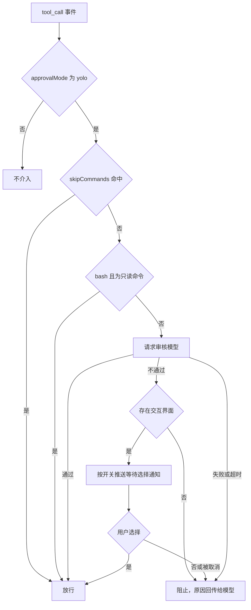

> [简体中文](README.md) · [English](README.en.md)

# omp-command-review

> <sub>*推荐使用 jev 或其他快速模型。*</sub>

oh-my-pi（omp-zh）扩展插件。在 `yolo` 审批模式下，它在工具调用执行前请求审核模型判定，把结论压缩为两类：通过即执行，不通过交用户决定。插件不改动 omp 源码。

**要求**：omp-zh ≥ 18.12.6；审核端点支持 Chat Completions、Responses 或 jev（TypeSafe System One）之一。

## 审核结论

| 结论 | 行为 |
| --- | --- |
| 通过 | 交给 omp 继续执行 |
| 不通过 | 交互界面显示审核原因与完整调用内容，由用户选择“是/否”；选择“是”才执行 |

审核失败与请求超时同样归入“不通过”。超时会中止请求，并把超时预算、端点、模型和 API 形态写入阻断原因，返回给正在工作的模型，便于它调整后续操作。

## 工作流程



## 安装

在插件目录执行：

```sh
omp-zh plugin install .
```

安装后重启 omp-zh。开发调试时可以用扩展参数临时加载，不必安装：

```sh
omp-zh --extension /绝对路径/omp-plugin-Command-review
```

## 配置

### 文件位置与优先级

插件读取两个 YAML 文件：

| 作用范围 | 路径 |
| --- | --- |
| 全局 | `~/.omp/agent/command-review.yml` |
| 项目 | `<项目>/.omp/command-review.yml` |

同名配置项的取值顺序为：项目文件 > 全局文件 > `omp-zh plugin config` > 环境变量 > 默认值。

配置文件出现未知字段或类型错误时，插件不会退回到宽松默认值，而是按安全策略阻止调用。

### 字段参考

| 字段 | 类型 | 默认值 | 说明 |
| --- | --- | --- | --- |
| `endpointUrl` | string | 无 | 审核服务地址。`api=jev` 时按后文规则推导 TypeSafe 端点。 |
| `api` | enum | `chat-completions` | `chat-completions`、`responses` 或 `jev`。 |
| `model` | string | 无 | 审核模型 ID。`api=jev` 时填 `jev-1.14.0` 这类 TypeSafe 模型名。 |
| `apiKey` | string | 无 | 直接写入密钥；也可写成 `${ENV_NAME}` 从环境变量取值。 |
| `apiKeyEnv` | string | 无 | 指定读取密钥的环境变量名，优先于 `apiKey` 的字面值。 |
| `skipCommands` | string[] | `[]` | 跳过审核的 glob 列表，也接受逗号或换行分隔的字符串。 |
| `auditLogEnabled` | boolean | `false` | 是否把审核记录写入项目内的 JSON 日志。 |
| `thinkingEnabled` | boolean | `false` | 是否启用模型思考模式；仅对 `chat-completions` 与 `responses` 生效。 |
| `reviewTimeoutMs` | number | `20000` | 审核请求超时毫秒数，实际取值受宿主钩子预算压缩（见[超时](#超时)）。 |
| `notifyEnabled` | boolean | `true` | 审核未通过、等待用户选择时是否推送终端通知；同时受 omp 的 `ask.notify` 约束（见[通知](#通知)）。 |
| `language` | enum | `zh-CN` | 面向用户的提示语言：`zh-CN` 为简体中文，`en` 为英文（见[语言](#语言)）。 |

### 完整示例

```yaml
endpointUrl: https://api.example.com/v1
api: chat-completions
model: gpt-4o-mini
apiKeyEnv: OMP_COMMAND_REVIEW_API_KEY
auditLogEnabled: true
thinkingEnabled: false
reviewTimeoutMs: 20000
notifyEnabled: true
language: zh-CN
skipCommands:
  - "read"
  - "grep"
  - "glob"
  - "edit"
  - "write"
  - "npm test*"
  - "pnpm lint"
  - "ask"
```

### 跳过的匹配规则

`skipCommands` 同时匹配两个候选值：工具名，以及审核文本（bash 为命令原文，其它工具为其入参序列化后的文本）。任一命中即跳过审核，不再请求模型。

匹配使用整串 glob，首尾隐含锚定，支持 `*`、`?` 与字符集合，因此 `read` 不会命中名为 `reader` 的工具，也不会命中 `read_file` 这类命令文本。要放行整个前缀，需要显式写成 `npm test*` 这样的形式。

`read`、`grep`、`glob`、`edit`、`write` 等工具不再写死在代码里：写进 `skipCommands` 即跳过，删掉条目即恢复审核。上面示例已包含这些工具名，可直接复制。

## 使用 jev

`jev` 走 TypeSafe System One 接口，不是 OpenAI 兼容格式。插件按官方结构发送一条 `choice` 问题，`state` 携带待审查内容：

```json
{
  "model": "jev-1.14.0",
  "state": "bash\nrm -rf ./build",
  "questions": {
    "decision": {
      "type": "choice",
      "instructions": "……判断这次工具调用是否可以直接执行，不需要人工确认。",
      "criteria": {
        "pass": "只读，或影响范围局限于当前项目且可逆；……",
        "review": "包含删除、覆盖……或后果不明确、需要人工判断。"
      }
    }
  }
}
```

插件只读取 `answers.decision.choice`：`pass` 对应通过，`review` 对应不通过，不解析自由文本。响应缺少 `answers`、`type` 不是 `choice`、`choice` 不在 `pass`/`review` 之内，或 HTTP 返回非成功状态时，都按审核失败阻断。

`endpointUrl` 的推导规则：

| 配置值形态 | 实际请求地址 |
| --- | --- |
| `https://www.dmxapi.cn` | `https://www.dmxapi.cn/typesafe/v1/systemone` |
| 以 `/v1` 结尾，如 `https://api.typesafe.ai/v1` | 追加 `/systemone` |
| 以 `/systemone` 结尾 | 原样使用 |

其它形态无法可靠推导，插件直接报错，避免把请求发到错误路径。

```yaml
endpointUrl: https://www.dmxapi.cn
api: jev
model: jev-1.14.0
apiKeyEnv: OMP_COMMAND_REVIEW_API_KEY
skipCommands:
  - "read"
  - "grep"
  - "glob"
  - "edit"
  - "write"
```

`jev` 不使用 `thinkingEnabled`。

## 审核行为

- 只拦截工具调用，且仅在有效 `tools.approvalMode` 为 `yolo` 时生效。omp-zh 的 `tool_call` 事件不携带审批模式，插件通过设置注册表读取该值，而不是等待 yolo 模式下不会触发的审批请求事件。
- 明确的只读 shell 命令（例如 `git status`、`rg`、`cat`、`npm list`）以及只由这些命令组成的命令链，直接放行，不发送给模型。带写入重定向、shell 展开、未知程序或可能修改状态的命令不按只读处理。
- 非 bash 工具的审核文本是入参 JSON，超过 8000 字符会截断并标注“已截断”。
- 模型调用失败、响应格式无效、请求超时或当前没有交互界面时，一律阻止执行，并把原因回传给工作中的模型。选择框被取消或返回无法识别的选项，同样按拒绝处理。
- 显式跳过项会绕开审核与确认，规则范围需要由使用者自行控制。

## 超时

审核请求有独立截止时间。实际取值是 `reviewTimeoutMs` 与宿主 `extensionHandlers.toolCallTimeoutMs` 的 80% 中的较小值，omp 默认钩子期限为 30000 毫秒。超时会中止 HTTP 请求、写入 `error` 审计结果，并按不通过阻止执行。

需要更长的审核时间时，先提高宿主钩子期限，再把插件超时设为更小的值：

```yaml
# ~/.omp/agent/config.yml
extensionHandlers:
  toolCallTimeoutMs: 60000
```

```yaml
# <项目>/.omp/command-review.yml
reviewTimeoutMs: 45000
```

## 通知

审核未通过时，插件会弹出「是 / 否」确认框。`notifyEnabled` 为 `true`（默认）时，插件在弹出确认框前推送一条终端通知，让离开终端的用户也能知道有命令在等确认。

通知复用 omp-zh 原生的终端通知通道，与 `ask` 工具等待输入时的通知同源：终端支持 OSC 99 时带 `focus` 动作（可在通知上直接聚焦会话），否则退化为一行文本或响铃；宿主判定为无头终端、或 `PI_NOTIFICATIONS` 为 `off` 时不发送。

推送还受宿主 `ask.notify` 设置约束：该设置为 `off` 时不发送，`on`（默认）或未设置时发送。

```yaml
# <项目>/.omp/command-review.yml
notifyEnabled: false
```

## 语言

`language` 决定面向用户的提示用哪种语言：`zh-CN`（默认）显示简体中文，`en` 显示英文。切换后，审核确认框的标题与选项、终端通知正文、以及阻断原因回传给模型的文字都会随之改变。

语言只影响用户可见文案。发给审核模型的提示词与 JEV 判据不随语言改变，审核行为在任何语言下保持一致。

配置值必须是 `zh-CN` 或 `en`；其它取值会让插件按安全策略阻止调用，而不是静默回落到默认语言。

```yaml
# <项目>/.omp/command-review.yml
language: en
```

## 日志

`auditLogEnabled: true` 时，插件把每次实际送审的调用与结论写入当前项目：

```text
<项目>/.omp/command-review-audit.json
```

文件是一个 JSON 数组。每次追加都会读取现有内容、整体重写并原子替换，同一目录下的写入串行执行，避免并发调用互相覆盖。

```json
[
  {
    "timestamp": "2026-10-24T00:00:00.000Z",
    "tool": "bash",
    "command": "rm -rf ./build",
    "input": "bash\nrm -rf ./build",
    "api": "jev",
    "model": "jev-1.14.0",
    "thinkingEnabled": false,
    "verdict": "review",
    "reason": "JEV 判定需要人工审查（置信度 0.98）。",
    "outcome": "blocked"
  }
]
```

`outcome` 取 `allowed`、`blocked` 或 `error`；`error` 记录会附带错误信息，超时也记为该值。日志默认关闭，写入失败不会改变审核结果，也不会中断流程。

日志可能包含命令、路径、参数和文件片段。启用前确认项目允许保存这些内容，并把 `.omp/command-review-audit.json` 加入忽略规则。

## 环境变量

| 变量 | 对应字段 |
| --- | --- |
| `OMP_COMMAND_REVIEW_URL` | `endpointUrl` |
| `OMP_COMMAND_REVIEW_API` | `api` |
| `OMP_COMMAND_REVIEW_API_KEY` | `apiKey` |
| `OMP_COMMAND_REVIEW_MODEL` | `model` |
| `OMP_COMMAND_REVIEW_SKIP_COMMANDS` | `skipCommands` |
| `OMP_COMMAND_REVIEW_AUDIT_LOG` | `auditLogEnabled` |
| `OMP_COMMAND_REVIEW_THINKING` | `thinkingEnabled` |
| `OMP_COMMAND_REVIEW_TIMEOUT_MS` | `reviewTimeoutMs` |
| `OMP_COMMAND_REVIEW_NOTIFY_ENABLED` | `notifyEnabled` |
| `OMP_COMMAND_REVIEW_LANGUAGE` | `language` |

```sh
export OMP_COMMAND_REVIEW_URL='https://api.example.com/v1'
export OMP_COMMAND_REVIEW_API='chat-completions'
export OMP_COMMAND_REVIEW_MODEL='your-model-id'
export OMP_COMMAND_REVIEW_API_KEY='your-api-key'
export OMP_COMMAND_REVIEW_SKIP_COMMANDS='read,grep,glob,edit,write,npm test*'
```

## 命令配置

```sh
omp-zh plugin config set omp-command-review endpointUrl https://api.example.com/v1
omp-zh plugin config set omp-command-review api chat-completions
omp-zh plugin config set omp-command-review model your-model-id
omp-zh plugin config set omp-command-review apiKey 'your-api-key'
omp-zh plugin config set omp-command-review auditLogEnabled true
omp-zh plugin config set omp-command-review thinkingEnabled true
omp-zh plugin config set omp-command-review reviewTimeoutMs 20000
omp-zh plugin config set omp-command-review notifyEnabled false
omp-zh plugin config set omp-command-review language en
omp-zh plugin config set omp-command-review skipCommands 'read,grep,glob,edit,write,npm test*'
```

插件按工作目录缓存已加载的配置。修改配置文件或插件设置后，需要重启 omp-zh 会话才会生效。

## 思考模式

思考模式复用 omp-zh 内置 `@oh-my-pi/pi-ai` 的策略：启用时不发送显式 effort，由服务端采用默认思考行为；`openai-responses` 使用服务端的 `reasoning` 默认值，`openai-completions` 使用服务端的 `reasoning_effort` 默认值。关闭时通过对应 API 的关闭推理参数实现，不直接拼接请求 JSON，两种格式因此保持兼容。具体强度由审核服务和模型决定，插件不固定为 low/medium/high。

## 隐私与安全

除跳过项和本地判定的只读命令外，每次工具调用的文本都会发送到配置的端点，并消耗该模型的 token。不要把不允许外发调用内容的项目接入本插件。

审核模型是概率性分类器，不构成沙箱。端点、网络链路和插件代码都需要可信。显式跳过项会跳过审核与确认，配置时应当把规则收得足够窄。

## 开发

```sh
bun test        # 单元测试
bun run typecheck   # 类型检查
```

代码结构：

| 文件 | 职责 |
| --- | --- |
| `src/index.ts` | 注册 `tool_call` 钩子，串联跳过判定、审核、确认与日志 |
| `src/config.ts` | 读取并合并配置文件、插件设置与环境变量 |
| `src/review.ts` | 按 `api` 分发到 OpenAI 兼容接口或 jev |
| `src/jev.ts` | 构造 TypeSafe 请求、推导端点、解析 choice 答案 |
| `src/policy.ts` | 只读命令识别、glob 跳过匹配、结论解析 |
| `src/audit.ts` | 写入 JSON 数组日志 |
| `src/confirmation.ts` | 交互确认框 |
| `src/notification.ts` | 等待用户选择时的终端通知，并读取宿主 `ask.notify` 开关 |
| `src/i18n.ts` | 中英文案目录与语言解析 |
| `src/format.ts` | 确认框里待执行命令的排版 |
| `src/errors.ts` | 可回传的错误类型 |

## [开源协议](LICENSE)

本项目以 MIT 协议发布，版权归 OrangeNeko 所有。使用、修改与再分发须遵守协议条款。

## [免责说明](DISCLAIMER.zh-CN.md)

本插件为辅助工具，不能替代沙箱、权限隔离或人工复核。使用前请阅读完整免责说明。
